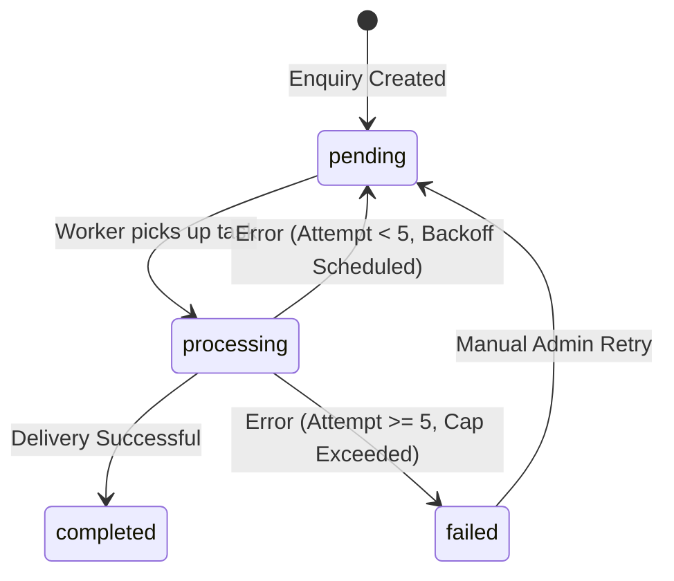

# Transactional Notification Outbox & Resilience Engine
**Project:** Libra Gems & Trading Co., Ltd.  
**Phase:** 05 – Enquiry Communications & Transactional Automation  
**Classification:** Technical Architecture Specification  
**Status:** Approved & Production-Ready  

---

## 1. Problem Statement & Motivation

In high-value B2B gemstone trading, the loss of an incoming client inquiry can result in significant financial loss. If transactional email delivery is executed synchronously within the HTTP request handler (`/api/enquiries`):
- Any third-party email outage, network hiccup, or API rate-limit throws an exception to the customer.
- If the customer retries, duplicate enquiries clutter the database.
- If the database commit depends on the email sending, a failed email causes a rollback, losing the customer's contact information forever.

To solve this, Phase 05 implements the **Transactional Outbox Pattern**.

---

## 2. Architectural Blueprint

```
[Public Website Client]
        │
        ▼ POST /api/enquiries
┌──────────────────────────────────────────────┐
│  Next.js Server API Route                    │
│  1. Validate Honeypot & Zod Schema           │
│  2. INSERT INTO public.enquiries             │
│  3. INSERT INTO public.notification_outbox   │
│     (customer_acknowledgement, admin_alert)  │
│  4. Return referenceNumber (Immediate 200 OK) │
└──────────────────────┬───────────────────────┘
                       │ (Asynchronous trigger)
                       ▼
┌──────────────────────────────────────────────┐
│  Outbox Worker Engine                        │
│  1. Lock row status = 'processing'           │
│  2. Dispatch via EmailProvider (Resend)      │
│  3. Success? -> status = 'completed'         │
│  4. Failure? -> status = 'pending',          │
│     attempt_count++, next_attempt_at = backoff│
│     Exhausted? -> status = 'failed'          │
└──────────────────────────────────────────────┘
```

---

## 3. Database Schema: `public.notification_outbox`

From `supabase/migrations/20261110000006_email_communications.sql`:

```sql
CREATE TABLE IF NOT EXISTS public.notification_outbox (
  id UUID PRIMARY KEY DEFAULT gen_random_uuid(),
  event_type TEXT NOT NULL CHECK (event_type IN ('enquiry_created', 'admin_reply', 'status_changed')),
  entity_type TEXT NOT NULL CHECK (entity_type IN ('enquiry', 'system')),
  entity_id TEXT NOT NULL,
  payload JSONB NOT NULL DEFAULT '{}'::jsonb,
  status TEXT NOT NULL CHECK (status IN ('pending', 'processing', 'completed', 'failed', 'cancelled')) DEFAULT 'pending',
  attempt_count INTEGER NOT NULL DEFAULT 0,
  max_attempts INTEGER NOT NULL DEFAULT 5,
  next_attempt_at TIMESTAMPTZ NOT NULL DEFAULT now(),
  processed_at TIMESTAMPTZ,
  last_error TEXT,
  created_at TIMESTAMPTZ NOT NULL DEFAULT now(),
  updated_at TIMESTAMPTZ NOT NULL DEFAULT now()
);

-- Partial index for high-performance outbox queue polling
CREATE INDEX IF NOT EXISTS idx_notification_outbox_queue 
  ON public.notification_outbox (status, next_attempt_at ASC) 
  WHERE status IN ('pending', 'failed');
```

---

## 4. State Lifecycle & Transitions



### Transition Rules:
1. **`pending`:** Initial state upon insertion or after a failed attempt awaiting its exponential backoff time.
2. **`processing`:** Optimistic concurrency lock. Only items matching `status IN ('pending', 'failed') AND next_attempt_at <= now()` are transitioned to `processing`.
3. **`completed`:** Delivery was confirmed by provider. `processed_at` timestamp is recorded and `last_error` is cleared.
4. **`failed`:** Retry count reached `max_attempts` (default: 5). The item is preserved for human review in `/admin/communications/outbox`.

---

## 5. Exponential Backoff Formula

When an outbox delivery fails, the next retry timestamp is calculated using exponential backoff capped at 24 hours:

$$\text{delayMinutes} = \min(2^{\text{attempt\_count}}, 1440)$$

| Attempt | Delay | Cumulative Time Since Ingestion |
|---|---|---|
| 1 | 2 minutes | 2 minutes |
| 2 | 4 minutes | 6 minutes |
| 3 | 8 minutes | 14 minutes |
| 4 | 16 minutes | 30 minutes |
| 5 | 32 minutes | 62 minutes (Exhausted, flagged for review) |

---

## 6. Execution Triggers

1. **Reactive Fire-and-Forget:** Upon successful enquiry insertion in `/api/enquiries`, `processOutbox({ limit: 10 })` is triggered asynchronously.
2. **Scheduled Cron Polling:** An authenticated endpoint `/api/cron/process-outbox` can be polled every 5 minutes by Vercel Cron or GitHub Actions using `Authorization: Bearer <CRON_SECRET>`.
3. **Interactive Admin Trigger:** The Admin Communication Center (`/admin/communications/outbox`) provides an interactive "Process Queue Now" button for instant manual execution.
