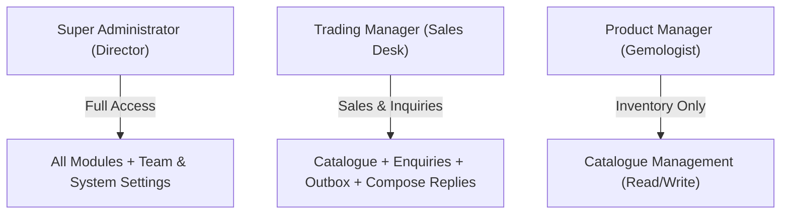
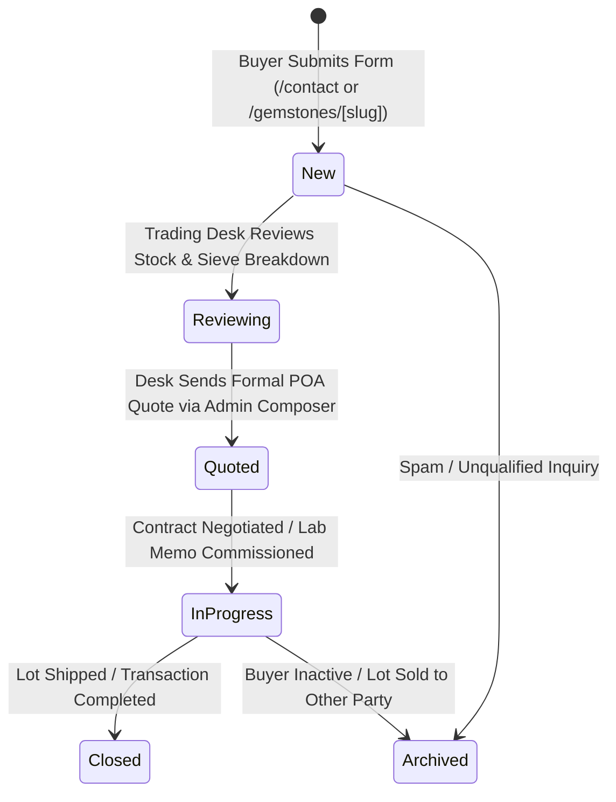

# Libra Gems & Trading Co., Ltd.
## Commercial Operations Handover & Trading Desk Manual

**Document Reference:** `docs/07-development/COMMERCIAL_OPERATIONS_HANDOVER.md`  
**Classification:** Business Operator Guide & Operational Handover Manual  
**Target Audience:** Libra Gems Managing Directors, Gemologists, and Sales Desk Operators  
**Location:** Bangkok, Thailand  
**Version:** 1.0.0 (Production Handover)

---

## 1. Introduction & Operational Philosophy

The Libra Gems digital platform is a **B2B wholesale enquiry and inventory presentation engine**, not a consumer e-commerce store. High-value colored gemstone trading relies on relationship building, physical parcel inspection, independent gemological laboratory testing, and bespoke contract negotiation.

This manual trains commercial personnel on day-to-day operations:
- Managing the international gemstone catalogue.
- Processing incoming wholesale enquiries.
- Sending formal trade quotations via transactional email.
- Monitoring automated outbox communications.
- Maintaining strict compliance with international gemological standards (CIBJO).

---

## 2. Administrator Access & Authentication

### 2.1 Accessing the Portal
1. Navigate to: `https://libragems.net/admin/login`
2. Enter your authorized corporate email address (e.g. `somchai@libragems.net`) and your master password.
3. Upon successful authentication, the system sets an encrypted, HTTP-only session cookie and redirects you to the Executive Dashboard at `/admin/dashboard`.

### 2.2 Role-Based Permissions
Your user account is assigned one of three operational roles:



- **`super_admin`:** Managing directors. Full control over gemstone inventory, wholesale enquiries, email communications, audit logs, and team personnel provisioning.
- **`trading_manager`:** Senior sales personnel. Full access to inventory, customer enquiries, and outbound quotation composition. Cannot provision new staff accounts.
- **`product_manager`:** Staff gemologists. Authorized to create and update gemstone records and photographs. Cannot access customer enquiries or outbound email communications.

---

## 3. Gemstone Catalogue & Inventory Management

### 3.1 Publishing a New Gemstone Lot (`/admin/gemstones/new`)
To publish a parcel or cut stone to the international catalogue:

1. **Navigate:** Go to **Catalogue** $\rightarrow$ Click **+ Add Gemstone**.
2. **Identification:**
   - **Gemstone Name:** Descriptive title (e.g. *Natural Ceylon Rough Hessonite Garnet Commercial Parcel*).
   - **Reference Code:** Unique internal stock code formatted as `LG-[SPECIES]-[LOT#]` (e.g. `LG-HG-001`, `LG-TQ-002`, `LG-RUB-003`).
   - **Category:** Select Rough Gemstones, Mineral Specimens, Cut Gemstones, or Beads.
3. **Gemological Specifications (Non-Fabrication Policy):**
   - **Species & Variety:** Official mineralogical classification (e.g. *Grossular Garnet / Hessonite*).
   - **Weight:** Enter exact metric weight in grams ($g$) or carats ($ct$). Check `tabular-nums` formatting.
   - **Sieve / Dimensions:** Enter millimeter sieve ranges or calibrated length $\times$ width $\times$ depth.
   - **Hardness & Specific Gravity:** Official mineralogical standards (e.g. 7.0–7.5 Mohs, 3.59–3.63 SG).
4. **Origin & Provenance Disclosure (CIBJO Standard):**
   - **Country & Region:** Specify sourcing origin (e.g. Sri Lanka / Ratnapura).
   - **Verification Status:** Choose:
     * `verified`: Accompanied by physical laboratory certificate from GIT, AIGS, Lotus Gemology, or GIA.
     * `trade_consensus`: Traditional trade sourcing; physical parcel characteristics match known locality.
     * `unverified`: Sourced via regional markets without formal origin documentation.
5. **Treatment Disclosure:**
   - **CIBJO Code:** Select `N` (Natural Untreated), `H` (Heated), or `T` (Treated / Polymer Stabilized).
   - **Treatment Note:** Provide complete factual disclosure.
6. **Publishing Controls:**
   - Toggle **Published** to `true` to display immediately on the public website.
   - Toggle **Featured** to `true` to highlight the lot on the homepage hero showcase.
7. **Save:** Click **Create Gemstone Lot**. Confirm that the success banner appears.

> [!CAUTION]
> **Strict Non-Fabrication Rule:** Never mark an origin as `verified` or treatment as `natural_untreated` without an official accredited laboratory report in hand. In particular, the Afghanistan Rubellite origin and treatment must not be presented as laboratory-confirmed without an accompanying GIT, Lotus, or AIGS memo.

---

## 4. Gemstone Digital Asset & Image Management

### 4.1 Photography Upload Guidelines
To maintain luxury editorial presentation and prevent security vulnerabilities:
- **Permitted File Formats:** JPEG (`.jpg`, `.jpeg`), PNG (`.png`), and WebP (`.webp`).
- **Prohibited Formats:** Scalable Vector Graphics (`.svg`), HTML, and executable files are blocked at the database storage policy level to prevent Stored Cross-Site Scripting (XSS).
- **File Size Limit:** Maximum 10 MB per image.
- **Lighting & Color Fidelity:** All photographs must be shot under standardized 5500K daylight lighting with neutral grey or natural paper backgrounds. Never apply artificial digital saturation filters.

### 4.2 Standard Photography Set (3 Angles per Lot)
1. **Overview View (`overview`):** Broad parcel shot showing color distribution and pebble size consistency.
2. **Macro Detail View (`macro`):** High-magnification close-up showing authentic surface texture, luster, and characteristic inclusions (e.g. treacle graining in hessonite, limonite veins in turquoise).
3. **Metric Scale View (`scale`):** Gemstones aligned alongside a metric millimeter trade ruler to visually substantiate sieve dimensions.

---

## 5. Wholesale Enquiry Management Workflow



### 5.1 Reviewing Inbound Enquiries (`/admin/enquiries`)
1. Inbound enquiries appear instantly with status `new` and a unique reference code (e.g. `ENQ-2026-10001`).
2. Click **View Enquiry** to inspect the customer's company name, country, specific gemstone interest, requested quantity, and message.
3. Review internal notes section to document telephone conversations or buyer qualification checks.

### 5.2 Responding to Buyers (Admin Response Composer)
To send a formal response from the official trading desk:
1. Open the enquiry at `/admin/enquiries/[id]`.
2. Scroll to the **Trading Desk Response Composer**.
3. Choose a response template (e.g. *Parcel Split Quotation*, *Bangkok Lab Memo Procedure*, or *FOB Bangkok Logistics*).
4. Customize the message with exact wholesale pricing (USD per gram/carat), parcel availability, and payment terms (Escrow / Bank Wire).
5. Click **Send Formal Reply**.
6. **Confirmation:** The message is queued in `public.email_outbox`, dispatched via Resend from `enquiries@libragems.net`, and logged in the enquiry's timeline.

---

## 6. Communication Center & Outbox Monitoring

### 6.1 Inspecting Outbox Deliveries (`/admin/communications/outbox`)
- The outbox records all automated notifications (customer acknowledgements and trading desk alerts).
- When operating normally, items move from `pending` to `sent` within seconds.
- **Manual Retry:** If an email fails (e.g. invalid client email or temporary mail server timeout), click **Retry Delivery** to immediately re-enqueue the message.

### 6.2 Monitoring Delivery Events (`/admin/communications/email-events`)
Review live email events received via Resend webhooks:
- `email.sent`: Accepted by Resend mail servers.
- `email.delivered`: Successfully accepted by the buyer's inbox server.
- `email.opened`: Buyer opened the message.
- `email.bounced`: Recipient address does not exist. (Action: Call buyer via WhatsApp).

---

## 7. Staff Management & Account Administration

### 7.1 Adding a New Employee Account
Only a `super_admin` may provision staff accounts:
1. Access the Supabase Console $\rightarrow$ **Authentication** $\rightarrow$ **Users** $\rightarrow$ Click **Add User**.
2. Enter the staff member's official corporate email (e.g. `firstname@libragems.net`) and a temporary 20-character password.
3. In the Supabase **SQL Editor**, execute the role assignment:
   ```sql
   INSERT INTO public.admin_users (id, email, full_name, role, is_active)
   SELECT id, email, 'Staff Full Name', 'trading_manager', true
   FROM auth.users
   WHERE email = 'firstname@libragems.net'
   ON CONFLICT (id) DO UPDATE SET role = EXCLUDED.role, is_active = true;
   ```
4. Instruct the employee to log in at `https://libragems.net/admin/login` and immediately update their password.

### 7.2 Terminating Staff Access
To immediately revoke administrative access:
1. In Supabase **SQL Editor**:
   ```sql
   UPDATE public.admin_users SET is_active = false WHERE email = 'departed_staff@libragems.net';
   ```
2. In **Authentication > Users**, select the user and click **Ban User**. This revokes all active session cookies.

---

## 8. Common Errors & Recovery Procedures

| Issue | Root Cause | Operator Recovery Action |
|---|---|---|
| **Image upload fails with error** | Uploaded file is SVG or $>10$ MB | Convert image to `.jpg` or `.webp` and compress below 10 MB before uploading. |
| **Outbox queue shows pending items** | Background cron delayed | Click **Retry Delivery** on the outbox item, or wait for next automatic background worker. |
| **Staff cannot log in** | Account inactive or wrong credentials | Verify user is active in `public.admin_users` table with `is_active = true`. |
| **Customer reports no acknowledgement email** | Email landed in spam or corporate firewall | Inspect `/admin/communications/email-events`. If `delivered`, advise buyer to check spam folder; alternatively message via WhatsApp. |
