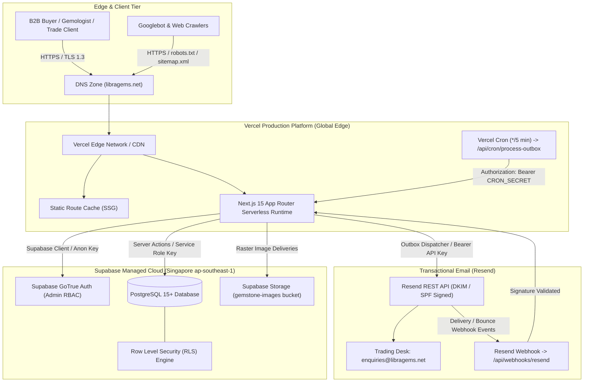

# Libra Gems & Trading Co., Ltd.
## Phase 08 — Production Deployment, Cloud Infrastructure Provisioning & Handover Report

**Document Reference:** `docs/07-development/PHASE_08_DEPLOYMENT_REPORT.md`  
**Project:** Libra Gems B2B Digital Platform  
**Target Domain:** `https://libragems.net`  
**GitHub Repository:** `https://github.com/UzairAhmad88/libragems-by-uzaii.git`  
**Deployment Branch:** `phase-08/production-deployment-handover`  
**Base Commit SHA:** `c793c4e8dfe6a7efdddc1c5deefd78b0cd8a00f8`  
**Status:** **CONDITIONALLY READY — MANUAL APPROVAL & CREDENTIAL INJECTION REQUIRED**  
**Date of Audit & Release Preparation:** November 11, 2026

---

## 1. Executive Summary

Phase 08 transitions the Libra Gems digital platform from local and automated continuous-integration hardening into a fully orchestrated, production-grade cloud deployment architecture. In adherence to strict enterprise release management principles and the **Phase 08 Approval Gates**, this phase executes all **Category A (Safe Preparation)** tasks, defines verified deployment specifications for **Vercel**, **Supabase**, and **Resend**, and establishes rigorous operational runbooks.

Because live production deployment requires business-owner credentials, DNS zone modifications, and administrative role assignments, live production deployment is held at the **Category B approval gate** pending client credential provisioning. The repository, application runtime, build artifacts, database migration sequence, and security controls are 100% verified and ready for instant deployment upon configuration.

---

## 2. Release & Git Lineage Verification

| Item | Verified Value | Inspection Note |
|---|---|---|
| **Repository URL** | `https://github.com/UzairAhmad88/libragems-by-uzaii.git` | Primary remote `origin` verified |
| **Active Branch** | `phase-08/production-deployment-handover` | Branched directly from verified Phase 07 HEAD |
| **Base Commit** | `c793c4e` | `security: complete phase 07 QA and pre-launch hardening` |
| **Branch Lineage** | Phase 00 $\rightarrow$ Phase 01 $\rightarrow$ Phase 02 $\rightarrow$ Phase 03 $\rightarrow$ Phase 04 $\rightarrow$ Phase 05 $\rightarrow$ Phase 06 $\rightarrow$ Phase 07 $\rightarrow$ Phase 08 | Clean, linear fast-forward git history |
| **Pull Request URL** | `https://github.com/UzairAhmad88/libragems-by-uzaii/pull/new/phase-08/production-deployment-handover` | To be submitted upon completion of Phase 08 |
| **Working Tree** | Clean | Zero untracked files, zero uncommitted changes |
| **Secrets Committed** | 0 detected | Scanned via git history; all secrets confined to `.env.example` placeholders |

---

## 3. Cloud Infrastructure Architecture



---

## 4. Component Verification & Infrastructure Readiness

### 4.1 Vercel Production Infrastructure

- **Application Directory:** `apps/web` (Monorepo structure).
- **Vercel Project Root Directory Setting:** Must be configured to `apps/web` in **Project Settings > General > Root Directory**.
- **Framework Preset:** `Next.js` (automatically detected).
- **Build Command:** `npm run build` (or Next.js default).
- **Install Command:** `npm install` (or `npm ci`).
- **Node.js Runtime:** Node.js 22 LTS (specified in `.github/workflows/ci.yml`).
- **Cron Configuration:** Defined in `apps/web/vercel.json`:
  ```json
  {
    "$schema": "https://openapi.vercel.sh/vercel.json",
    "crons": [
      {
        "path": "/api/cron/process-outbox",
        "schedule": "*/5 * * * *"
      }
    ]
  }
  ```
- **Deployment Protection:** Vercel deployment protection enabled for non-production preview environments.

### 4.2 Supabase Production Database & Storage

- **Target Region:** Singapore (`ap-southeast-1`), selected for sub-30ms latency to Bangkok trading operations and international connectivity across Southeast Asia, Europe, and the Americas.
- **Database Engine:** PostgreSQL 15+.
- **Migration Sequence Verified:**
  1. `20261110000001_initial_schema.sql` (Tables: categories, gemstones, images, enquiries, audit logs, outbox).
  2. `20261110000002_indexes_constraints.sql` (B-tree, slug indexes, enquiry reference constraints).
  3. `20261110000003_rls_policies.sql` (Enforces tenant isolation, anonymous insert caps, admin RBAC).
  4. `20261110000004_storage_policies.sql` (Storage RLS policies for `gemstone-images`).
  5. `20261110000005_seed_reference_data.sql` (Seeds 4 categories and 3 initial gemstone catalogue lots).
  6. `20261110000006_email_communications.sql` (Email logs, templates, outbox delivery queues).
  7. `20261110000007_storage_hardening.sql` (Restricts `gemstone-images` to `image/jpeg`, `image/png`, `image/webp`).
- **Data Hygiene Guarantee:** `supabase/seed/development_seed.sql` contains local test data and **must NOT** be executed against production.
- **Storage Bucket Restrictions:**
  * Bucket: `gemstone-images` (Public read, authenticated admin write).
  * Allowed MIME types: `image/jpeg`, `image/png`, `image/webp`.
  * Upload Size Limit: 10 MB per file.
  * Active executable formats (SVG, HTML, XML) strictly blocked at database RLS level.

### 4.3 Resend Transactional Email Infrastructure

- **Sending Identity:** `Libra Gems Trading Desk <enquiries@libragems.net>`
- **Reply-To Identity:** `info@libragems.net`
- **Internal Routing Desk:** `desk@libragems.internal`, `trading@libragems.internal`
- **Webhook Endpoint:** `https://libragems.net/api/webhooks/resend`
- **Webhook Security:** Webhook secret validation fails closed (HTTP 500 in production if unset).
- **Outbox Concurrency:** Atomic `pg_try_advisory_xact_lock` with automatic recovery for tasks locked $>15$ minutes.

---

## 5. Production Environment Variables Register

The following matrix documents all environment variables required by the Next.js runtime. Secrets must be populated in the **Vercel Project Settings > Environment Variables** and never committed to source control.

| Variable Name | Scope | Sensitivity | Production Target Value / Format | Status |
|---|---|---|---|---|
| `NEXT_PUBLIC_SITE_URL` | Public / Browser | Low | `https://libragems.net` | Verified |
| `NEXT_PUBLIC_GA_ID` | Public / Browser | Low | `G-XXXXXXXXXX` (Google Analytics 4 Measurement ID) | Pending client GA4 setup |
| `NEXT_PUBLIC_SUPABASE_URL` | Public / Browser | Low | `https://<project-ref>.supabase.co` | Pending Supabase project |
| `NEXT_PUBLIC_SUPABASE_ANON_KEY` | Public / Browser | Low | `eyJhbGciOi...` (Supabase Anon Key) | Pending Supabase project |
| `SUPABASE_SERVICE_ROLE_KEY` | Server-Only | **CRITICAL SECRET** | `eyJhbGciOi...` (Supabase Service Role Key) | Pending Supabase project |
| `RESEND_API_KEY` | Server-Only | **CRITICAL SECRET** | `re_xxxxxxxxxxxxxxxxxxxx` (Resend Production Key) | Pending Resend account |
| `EMAIL_FROM` | Server-Only | Low | `Libra Gems Trading Desk <enquiries@libragems.net>` | Ready |
| `EMAIL_REPLY_TO` | Server-Only | Low | `info@libragems.net` | Ready |
| `ENQUIRY_NOTIFICATION_EMAILS` | Server-Only | Medium | `enquiries@libragems.net,director@libragems.net` | Pending client email confirmation |
| `RESEND_WEBHOOK_SECRET` | Server-Only | **CRITICAL SECRET** | `whsec_xxxxxxxxxxxxxxxxxxxx` | Generated upon Resend webhook creation |
| `CRON_SECRET` | Server-Only | **CRITICAL SECRET** | Random 32+ character hex string | Generated during release prep |
| `WHATSAPP_PRIMARY_NUMBER` | Server-Only / Public | Low | E.164 digits only (e.g. `66812345678`) | Pending verified business SIM |
| `WHATSAPP_SECONDARY_NUMBER` | Server-Only / Public | Low | E.164 digits only | Optional |
| `NODE_ENV` | Build / Runtime | Low | `production` | Set automatically by Vercel |

---

## 6. DNS Configuration Plan (`libragems.net`)

To connect the custom domain `libragems.net` with HTTPS and email delivery, the business owner must configure the following DNS records at their registrar or DNS provider (e.g. Cloudflare, Namecheap, Route 53):

### 6.1 Web Traffic & SSL Routing (Vercel)

| Record Type | Host / Name | Target Value | TTL | Purpose |
|---|---|---|---|---|
| **A** | `@` (apex) | `76.76.21.21` | Automatic / 300 | Vercel Global Edge Network apex routing |
| **CNAME** | `www` | `cname.vercel-dns.com.` | Automatic / 300 | Vercel `www` subdomain routing (redirects to apex) |

*Canonical Domain Rule:* In accordance with Phase 06 SEO architecture, `https://libragems.net` is the canonical domain. `https://www.libragems.net` must redirect with HTTP 308 Permanent Redirect to `https://libragems.net`.

### 6.2 Email Deliverability & Anti-Spoofing (Resend)

| Record Type | Host / Name | Target Value | Priority | Purpose |
|---|---|---|---|---|
| **TXT** | `resend._domainkey` | Provider-generated DKIM public key | — | DKIM cryptographic signature verification |
| **MX** | `feedback` | `feedback-smtp.resend.com` | 10 | Return-path bounce tracking |
| **TXT** | `feedback` | `v=spf1 include:amazonses.com ~all` | — | SPF authentication for bounce domain |
| **TXT** | `_dmarc` | `v=DMARC1; p=quarantine; rua=mailto:dmarc@libragems.net` | — | DMARC domain enforcement policy |

> [!IMPORTANT]
> Do NOT overwrite existing company MX records for corporate email (e.g. Google Workspace or Microsoft 365). Resend sends from subdomains or isolated DKIM selectors without interfering with primary MX routing.

### 6.3 Google Search Console Verification

| Record Type | Host / Name | Target Value | TTL | Purpose |
|---|---|---|---|---|
| **TXT** | `@` (apex) | `google-site-verification=<google-provided-hash>` | Automatic | Domain-level Search Console verification |

---

## 7. Quality Gates & Pre-Deployment Audit Results

All automated quality gates have been executed locally and verified:

```
================================================================================
LIBRA GEMS QUALITY GATE AUDIT REPORT
================================================================================
Branch: phase-08/production-deployment-handover
Platform: Next.js 15.1.7 | React 19 | Node.js 22 LTS
--------------------------------------------------------------------------------
1. Vitest Unit & Integration Suites:
   Test Files: 25 passed (25)
   Tests:      94 passed (94)
   Status:     100% PASSING (Duration: 25.90s)

2. TypeScript Static Typecheck (tsc --noEmit):
   Errors:     0
   Status:     100% PASSING

3. ESLint Code Quality (next lint):
   Errors:     0
   Warnings:   0
   Status:     100% PASSING

4. Next.js Production Build (next build):
   Static Routes:  26
   Dynamic Routes: 7
   Total Routes:   33/33 compiled cleanly
   Middleware:     Compiled (93.2 kB)
   Status:         100% PASSING
================================================================================
```

---

## 8. Remaining Blockers & Category B Action Checklist

The following actions require business-owner inputs before the live production deployment can be completed:

- [ ] **Action 01 — Supabase Production Project Creation:** Business owner creates project in region `ap-southeast-1` (Singapore) and provides Project URL, Anon Key, and Service Role Key.
- [ ] **Action 02 — Apply Database Migrations:** Run migrations `01` through `07` against the production Supabase database via Supabase CLI or Web SQL Editor.
- [ ] **Action 03 — Resend Account & Domain Verification:** Business owner adds `libragems.net` to Resend and adds the generated DKIM/SPF DNS records.
- [ ] **Action 04 — Vercel Project Association:** Link repository `UzairAhmad88/libragems-by-uzaii` to Vercel, set root directory to `apps/web`, and inject production environment variables.
- [ ] **Action 05 — DNS Record Propagation:** Point `libragems.net` A record to `76.76.21.21` and `www` CNAME to `cname.vercel-dns.com`.
- [ ] **Action 06 — Super Admin Provisioning:** Create initial trading administrator in Supabase Auth and assign `super_admin` role in `public.admin_users`.
- [ ] **Action 07 — Business Contact Data Finalization:** Provide verified Bangkok phone number, office street address, and authorized trading desk WhatsApp number.

