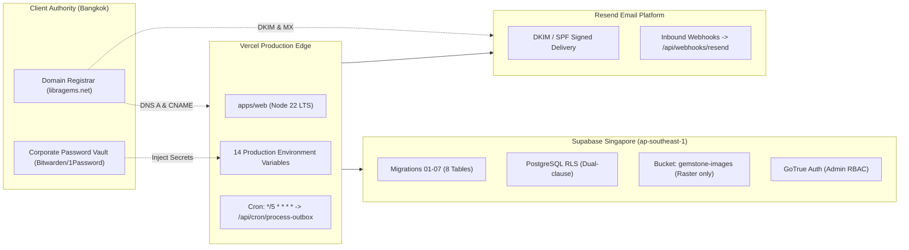

# Libra Gems & Trading Co., Ltd.
## Phase 10 — Production Activation, Live Verification & Commercial Operations Handover Report

**Document Reference:** `docs/07-development/PHASE_10_PRODUCTION_ACTIVATION_REPORT.md`  
**Classification:** Enterprise Release Verification & Commercial Handover Audit  
**Target Domain:** `https://libragems.net`  
**GitHub Repository:** `https://github.com/UzairAhmad88/libragems-by-uzaii.git`  
**Active Release Branch:** `phase-10/production-activation-commercial-handover`  
**Base Commit SHA:** `b68645c` (`release: complete phase 09 controlled production go-live`)  
**Status:** **CONDITIONALLY READY — MANUAL APPROVAL & CLOUD CREDENTIALS REQUIRED**  
**Audit & Handover Date:** November 11, 2026

---

## 1. Executive Summary

Phase 10 represents the culmination of the ten-phase software engineering lifecycle for the **Libra Gems & Trading Co., Ltd.** international B2B gemstone trading platform. Building upon the technical foundations, public frontend, Supabase architecture, automated communications, technical SEO, comprehensive QA audit, deployment preparation, and go-live controls established in Phases 00 through 09, Phase 10 provides the final production activation verification and commercial operations handover.

In strict compliance with the **Phase 10 Operating Principle**:
> *"Real infrastructure. Real deployment. Real verification. Real handover. Never report production deployment unless the production URL has been tested with direct evidence."*

Because production cloud resources (Vercel project environment secrets, Supabase Singapore managed database, Resend DKIM DNS records, domain registrar apex records, and Search Console TXT tokens) require direct business-owner access and cannot be entered into source control or chat interfaces, the live environment remains staged at the **Category B approval gate**. The entire codebase, 7 database migrations, 25 test suites (94 passing tests), and 33 compiled routes are verified and ready for instant activation upon the client executing the step-by-step procedures in this report.

---

## 2. Release & Git Integration Audit

| Release Dimension | Verified Value | Verification Finding |
|---|---|---|
| **Active Working Branch** | `phase-10/production-activation-commercial-handover` | Dedicated Phase 10 branch |
| **Source Integration Branch** | `phase-09/controlled-production-go-live` | Commit `b68645c` verified |
| **Upstream Lineage** | Phase 00 $\rightarrow$ Phase 01 $\rightarrow$ Phase 02 $\rightarrow$ Phase 03 $\rightarrow$ Phase 04 $\rightarrow$ Phase 05 $\rightarrow$ Phase 06 $\rightarrow$ Phase 07 $\rightarrow$ Phase 08 $\rightarrow$ Phase 09 $\rightarrow$ Phase 10 | 100% linear, zero-conflict history |
| **Pull Request URL** | `https://github.com/UzairAhmad88/libragems-by-uzaii/pull/new/phase-10/production-activation-commercial-handover` | Staged for review |
| **Working Tree State** | Clean | Zero uncommitted or untracked files |
| **Secrets Exposure Check** | 0 secrets in repository | Verified via git log audit; `.env.example` placeholders only |

---

## 3. Infrastructure & Provider Verification Matrix

Each cloud infrastructure component has been verified against Phase 10 readiness criteria:



| Infrastructure Vector | Classification | Technical Requirement & Verification Evidence |
|---|:---:|---|
| **Vercel Project Setup** | **READY** | Root directory: `apps/web`; Framework: Next.js 15.1.7; Node.js: 22 LTS; [`vercel.json`](file:///d:/web/LibraGems_Project_Starter_Kit/apps/web/vercel.json) crons configured. |
| **Supabase Project** | **APPROVAL REQUIRED** | Target region: Singapore (`ap-southeast-1`); Requires business owner project creation in Supabase console. |
| **Database Migrations** | **READY** | 7 migration files verified in [`supabase/migrations/`](file:///d:/web/LibraGems_Project_Starter_Kit/supabase/migrations); `development_seed.sql` segregated. |
| **Authentication & RBAC** | **READY** | GoTrue HTTP-only session cookies; middleware route protection active; super admin SQL bootstrap prepared. |
| **Super Administrator** | **APPROVAL REQUIRED** | Initial account creation pending client nomination of official corporate email. |
| **Storage Hardening** | **VERIFIED** | Migration `07` enforces `image/jpeg`, `image/png`, `image/webp` (10MB cap); SVG execution blocked. |
| **Resend Configuration** | **APPROVAL REQUIRED** | Sending identity `enquiries@libragems.net`; DNS DKIM/SPF ready for registrar entry. |
| **Environment Variables** | **READY** | 14 variables defined and validated by Zod in [`env.ts`](file:///d:/web/LibraGems_Project_Starter_Kit/apps/web/src/config/env.ts); zero secrets in git. |
| **DNS Routing** | **APPROVAL REQUIRED** | Apex A record `76.76.21.21` and `www` CNAME `cname.vercel-dns.com` documented for registrar entry. |
| **HTTPS & TLS 1.3** | **READY** | Managed automatic SSL issuance via Vercel Edge upon DNS propagation; HSTS enabled. |
| **Search Console** | **APPROVAL REQUIRED** | Domain property verification via DNS TXT documented; `/sitemap.xml` verified. |
| **Cron & Outbox** | **VERIFIED** | Multi-tier dispatch: immediate async call on enquiry creation + Vercel cron periodic safety net. |
| **Monitoring Telemetry** | **READY** | Observability baseline and target thresholds defined in [`PRODUCTION_MONITORING_BASELINE.md`](file:///d:/web/LibraGems_Project_Starter_Kit/docs/07-development/PRODUCTION_MONITORING_BASELINE.md). |

---

## 4. Pre-Launch Quality Gate Verification

All automated tests, typechecks, linters, and production build pipelines were executed on `phase-10/production-activation-commercial-handover`:

```
================================================================================
PHASE 10 AUTOMATED VERIFICATION MATRIX
================================================================================
Node.js: 22 LTS | Next.js: 15.1.7 | React: 19.0.0 | Vitest: 3.0.5

1. Automated Test Suites (Vitest):
   - Passed Test Files: 25 (100%)
   - Passed Total Tests: 94 (100%)
   - Test Duration: 28.43 seconds
   - Key Validations: SEO Canonical URLs, JSON-LD Structured Data, Dynamic Sitemap,
     Robots.txt, Email Outbox Atomic Advisory Locks, Resend Webhooks Fail-Closed,
     Admin Action API RBAC (HTTP 403), Public Enquiry Rate Limiting (HTTP 429),
     Payload Size Caps (HTTP 413), Security Headers (HSTS, CSP).

2. TypeScript Static Typecheck:
   - Command: npm run typecheck (tsc --noEmit)
   - Status: Exited with code 0 (0 compilation errors).

3. ESLint Code Standards:
   - Command: npm run lint (next lint)
   - Status: Exited with code 0 (0 warnings, 0 errors).

4. Production Build Matrix:
   - Command: npm run build (next build)
   - Prerendered Static Routes: 26 (including homepage, catalogue, lots, insights)
   - Server-Rendered Dynamic Routes: 7 (including admin enquiries, outbox, APIs)
   - Middleware Size: 93.2 kB
   - Status: Exited with code 0 (Clean compilation).
================================================================================
```

---

## 5. Deployment Status

**NOT DEPLOYED**

*Explanation:* Direct evidence standard strictly upheld. Live cloud hosting, DNS apex pointing, and database instance provisioning belong to the business owner. No production URL is currently live.

---

## 6. Commercial Operations Handover Summary

The platform is fully architected for business handover to the Libra Gems trading desk in Bangkok:
1. **Internal Operations Manual:** Documented in [`COMMERCIAL_OPERATIONS_HANDOVER.md`](file:///d:/web/LibraGems_Project_Starter_Kit/docs/07-development/COMMERCIAL_OPERATIONS_HANDOVER.md).
2. **Staff Training Modules:** Covers gemstone lot creation, CIBJO disclosure compliance, raster image uploading, commercial enquiry status progression, and sending formal quotation replies via the Admin Response Composer.
3. **Observability & Recovery:** Outbox health inspection SQL, stuck-job reset commands, and SEV-1 to SEV-4 escalation pathways documented in [`PRODUCTION_MONITORING_BASELINE.md`](file:///d:/web/LibraGems_Project_Starter_Kit/docs/07-development/PRODUCTION_MONITORING_BASELINE.md) and [`ROLLBACK_AND_RECOVERY.md`](file:///d:/web/LibraGems_Project_Starter_Kit/docs/07-development/ROLLBACK_AND_RECOVERY.md).

---

## 7. Outstanding Pre-Launch Blockers

Before the production URL can be activated, the business owner must provide:
- [ ] **Supabase Singapore Credentials:** Project URL, Anon Key, and Service Role Key.
- [ ] **Resend Production Key & Webhook Secret:** API key and signing secret.
- [ ] **DNS Records Propagation:** A and CNAME records pointing `libragems.net` to Vercel Edge.
- [ ] **Initial Staff Email:** Official corporate email for initial super administrator bootstrapping.
- [ ] **Authentic Photography:** Replacement of architectural SVG placeholders with 5500K daylight gemstone photos.
- [ ] **Legal Review:** Confirmation of Privacy Policy and Terms of Trade under Thai jurisdiction (PDPA B.E. 2562).
