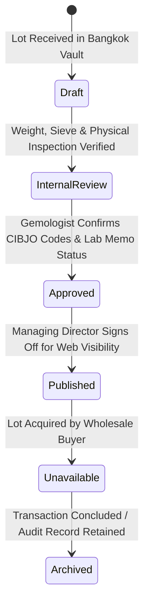

# Libra Gems & Trading Co., Ltd.
## Phase 11 — Commercial Catalogue Readiness & Gemological Governance

**Document Reference:** `docs/07-development/PHASE_11_COMMERCIAL_CATALOGUE_READINESS.md`  
**Classification:** Commercial Product Governance & Gemological Disclosure Standard  
**Target Domain:** `https://libragems.net`  
**Version:** 1.0.0 (Commercial Handover)

---

## 1. Gemstone Inventory Lifecycle Workflow

To maintain absolute credibility in international colored stone markets, all gemstone lots progress through a strict five-stage editorial and gemological lifecycle:

1. **`Draft`:** Raw lot data entered into `/admin/gemstones/new` by warehouse staff (weights, sieve ranges, initial inspection notes). Not visible on public website.
2. **`Internal Review`:** Staff gemologist conducts optical and gemological inspection, confirms species/variety, and determines CIBJO disclosure code.
3. **`Approved`:** Lot specifications, photography, and laboratory documentation verified. Awaiting commercial signoff.
4. **`Published`:** Lot toggled to `is_published: true`. Renders immediately on `https://libragems.net/gemstones`.
5. **`Unavailable / Archived`:** Lot sold or reserved. Toggled to `availability_status: 'sold'` or archived for historical reference.

---

## 2. Baseline Inventory Audit: Initial 3 Commercial Lots

The launch catalogue features three representative commercial parcels curated for wholesale cutters, jewelry manufacturers, and connoisseurs:

### 2.1 Lot 1: Commercial-Quality Rough Hessonite Garnet
- **Reference Code:** `LG-HG-001`
- **Slug:** `/gemstones/hessonite-garnet`
- **Category:** Rough Gemstones (`rough`)
- **Mineralogical Classification:** Species: *Grossular Garnet* | Variety: *Hessonite Garnet*
- **Formula & Constants:** $\text{Ca}_3\text{Al}_2(\text{SiO}_4)_3$ | Hardness: 7.0–7.5 Mohs | SG: 3.59–3.63 | RI: 1.734–1.748 (Singly refractive)
- **Lot Size & MOQ:** Total Parcel: 5,000 g alluvial rough pebbles | Minimum Order Quantity: 500 g split
- **Sieve Range:** 8 mm – 22 mm average alluvial pebbles
- **Origin Disclosure (CIBJO):** Sri Lanka, Ratnapura Alluvial Gravels | Verification Status: `trade_consensus` (Sourced through established Ratnapura trading desks; physical crystal morphology diagnostic of alluvial gravels).
- **Treatment Disclosure:** Natural Untreated (**CIBJO Code N**). Completely unheated and unenhanced.
- **Laboratory Memo Option:** Random sample or whole-parcel gemological identification reports available on request via GIT, AIGS, or Lotus Gemology prior to export.

### 2.2 Lot 2: Commercial-Quality Turquoise
- **Reference Code:** `LG-TQ-001`
- **Slug:** `/gemstones/turquoise`
- **Category:** Mineral Specimens & Rough (`mineral`)
- **Mineralogical Classification:** Species: *Turquoise* | Variety: *Natural Matrix Turquoise*
- **Formula & Constants:** $\text{CuAl}_6(\text{PO}_4)_4(\text{OH})_8\cdot 4\text{H}_2\text{O}$ | Hardness: 5.0–6.0 Mohs | SG: 2.60–2.85 | RI: 1.61–1.65 (Spot reading)
- **Lot Size & MOQ:** Total Lot: 12.5 kg nodules and pre-sawn slabs | Minimum Order Quantity: 1.0 kg lot
- **Dimensions:** 25 mm – 75 mm rough nodules and lapidary slabs
- **Origin Disclosure (CIBJO):** Central Asian Mineralized Belt | Verification Status: `unverified` (Trade sourced through regional mineral desks; sold on physical grade rather than mine provenance).
- **Treatment Disclosure:** Polymer Stabilized (**CIBJO Code T**). Ethical polymer enhancement seals capillaries and guarantees structural durability during cutting and setting.
- **Laboratory Memo Option:** Species confirmation and polymer stabilization disclosure verified via GIT standard spectroscopy testing.

### 2.3 Lot 3: Afghanistan Cut-Stone Rubellite
- **Reference Code:** `LG-RUB-AFGHAN`
- **Slug:** `/gemstones/afghanistan-rubellite`
- **Category:** Cut Gemstones (`cut`)
- **Mineralogical Classification:** Species: *Elbaite Tourmaline* | Variety: *Rubellite Tourmaline*
- **Formula & Constants:** $\text{Na}(\text{Li},\text{Al})_3\text{Al}_6(\text{BO}_3)_3\text{Si}_6\text{O}_{18}(\text{OH})_4$ | Hardness: 7.0–7.5 Mohs | SG: 3.01–3.06 | RI: 1.624–1.644
- **Form & Carat Weight:** Single precision-faceted custom oval mixed cut | Carat weight confirmed upon formal laboratory memo.
- **Origin Disclosure (CIBJO):** Afghanistan, Kunar / Nuristan Pegmatite Belt | Verification Status: `trade_consensus` (Historical trade sourcing; formal geographical origin determination arranged via specialized trace-element laboratory report).
- **Treatment Disclosure:** Probable Standard Trade Heating / Lab Verification Required (**CIBJO Code N/H**).
- **Laboratory Memo Option:** Full origin and treatment identification reports arranged through accredited Bangkok laboratories (GIT, Lotus Gemology, AIGS, or GIA) prior to contract finalization.

---

## 3. Commercial Photography & Digital Asset Transition

### 3.1 Standard Photography Specifications
When replacing the initial architectural vector SVGs with authentic commercial photography:
- **Format Requirements:** JPEG (`.jpg`), PNG (`.png`), or WebP (`.webp`). File size strictly $\le 10\text{ MB}$.
- **Lighting Standard:** Photographed under standardized 5500K (D65) daylight-balanced lamps.
- **Backgrounds:** Neutral 18% photographic grey card or natural off-white art paper (`#F3EFE5`).
- **Zero Digital Distortion:** Software retouching to artificially intensify saturation or conceal fractures is strictly forbidden under CIBJO ethics rules.

### 3.2 Required Three-Angle Photographic Set
1. **Overview Perspective (`overview`):** Broad parcel shot displaying color consistency across the entire lot.
2. **Macro Inclusions Perspective (`macro`):** High-magnification close-up highlighting surface luster, crystalline structure, and diagnostic natural inclusions.
3. **Metric Scale Perspective (`scale`):** Gemstones positioned against a calibrated millimeter trade ruler.

---

## 4. International Trade Compliance & Non-Fabrication Policy

Libra Gems upholds the highest ethical standards of the World Jewellery Confederation (CIBJO):
- **Zero Synthetic Reviews:** The platform strictly prohibits displaying fabricated customer testimonials or trust badges.
- **No Deceptive Pricing:** Non-priced wholesale lots declare **Price on Application (POA)**. Schema.org structured data strictly omits deceptive `$0.00` prices (ADR-29).
- **Accredited Laboratory Primacy:** Laboratory findings supersede visual estimates. If laboratory spectroscopy reports indicate heat or polymer treatment, disclosures are updated immediately.
