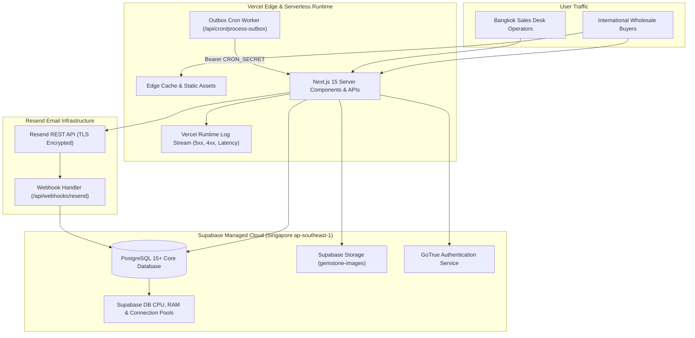

# Libra Gems & Trading Co., Ltd.
## Phase 11 — Production Monitoring, Observability & Incident Response Guide

**Document Reference:** `docs/07-development/PHASE_11_MONITORING_AND_INCIDENT_GUIDE.md`  
**Classification:** SRE & Production Incident Response Runbook  
**Target Domain:** `https://libragems.net`  
**Version:** 1.0.0 (Production Operations)

---

## 1. Observability Architecture & Health Metrics



---

## 2. Operational Baselines & Target Service Levels (SLAs)

| Operational Metric | Target Baseline | Warning Threshold | Critical Incident (SEV-1/2) | Remediation Path |
|---|---|---|---|---|
| **Public Homepage TTFB** | $< 350\text{ ms}$ | $> 800\text{ ms}$ | $> 2,000\text{ ms}$ | Inspect Vercel edge cache headers; verify SSR queries. |
| **Largest Contentful Paint (LCP)** | $< 1.8\text{ s}$ | $> 2.5\text{ s}$ | $> 4.0\text{ s}$ | Verify image optimization and hero SVG preloading. |
| **Cumulative Layout Shift (CLS)** | $< 0.05$ | $> 0.10$ | $> 0.25$ | Audit spec table dimensions and font-display properties. |
| **API Error Rate (5xx)** | $< 0.01\%$ | $> 0.5\%$ | $> 2.0\%$ | Inspect Vercel runtime logs for unhandled exceptions. |
| **Enquiry Submission Latency** | $< 400\text{ ms}$ | $> 1,000\text{ ms}$ | $> 3,000\text{ ms}$ | Check PostgreSQL connection pool saturation. |
| **Email Dispatch Latency** | $< 60\text{ s}$ | $> 5\text{ min}$ | $> 15\text{ min}$ | Run outbox processor manual trigger or check cron status. |
| **Email Bounce Rate** | $< 1.0\%$ | $> 3.0\%$ | $> 5.0\%$ | Check Resend suppression list; verify buyer domain validity. |
| **Database Pool Connections** | $< 15\text{ active}$ | $> 40\text{ active}$ | $> 80\text{ active}$ | Audit connection pool pooling mode (transaction vs session). |

---

## 3. Outbox Queue SQL Diagnostic Runbook

To inspect communication health or recover stalled notifications, execute these non-destructive queries in the Supabase SQL Editor:

```sql
-- 1. Inspect Outbox Queue Distribution by Status
SELECT 
  status, 
  COUNT(*) AS total_count,
  MIN(created_at) AS oldest_enqueued,
  MAX(attempts) AS max_attempts
FROM public.email_outbox
GROUP BY status;

-- 2. Check for Abandoned Processing Jobs (> 15 minutes)
SELECT id, recipient, subject, attempts, updated_at
FROM public.email_outbox
WHERE status = 'processing'
  AND updated_at < (NOW() - INTERVAL '15 minutes');

-- 3. Reset Abandoned Jobs to Pending (Automatic Recovery)
UPDATE public.email_outbox
SET status = 'pending',
    updated_at = NOW()
WHERE status = 'processing'
  AND updated_at < (NOW() - INTERVAL '15 minutes');

-- 4. Review Most Recent Failed Notifications
SELECT id, recipient, subject, last_error, attempts, updated_at
FROM public.email_outbox
WHERE status = 'failed'
ORDER BY updated_at DESC
LIMIT 10;
```

---

## 4. Incident Severity Classification & Response Matrix

| Severity Level | Operational Impact | Typical Scenarios | Maximum Response Time | Lead Responder |
|---|---|---|---|---|
| **SEV-1 (Critical)** | Entire public site offline or customer data compromised. | - 5xx errors across homepage.<br>- Apex TLS certificate expiry.<br>- RLS breach on enquiries table. | $< 15\text{ minutes}$ | Principal Architect & DevOps Lead |
| **SEV-2 (Major)** | Core transactional workflow non-functional. | - Enquiry form submission failing.<br>- Admin dashboard login failing.<br>- Outbox processor deadlocking. | $< 1\text{ hour}$ | Senior Full-Stack Engineer |
| **SEV-3 (Moderate)** | Non-critical feature degraded; business operations continue. | - Webhook delivery events delayed.<br>- Image upload failing in admin panel.<br>- Slow page transitions ($>3\text{s}$). | $< 4\text{ hours}$ | Frontend / Support Engineer |
| **SEV-4 (Minor)** | Minor cosmetic defect or reporting anomaly. | - Misaligned spec table cell.<br>- Minor analytics tag warning. | $< 24\text{ hours}$ | UI/UX Developer |

---

## 5. Rapid Rollback & Disaster Recovery Procedures

### 5.1 Vercel Instant Application Rollback ($< 60\text{ Seconds}$)
1. Access the Vercel Dashboard at `https://vercel.com/dashboard`.
2. Select project `libragems-web` $\rightarrow$ Open the **Deployments** tab.
3. Locate the last known healthy deployment by its Git commit SHA.
4. Click the three dots menu (`...`) $\rightarrow$ Click **Instant Rollback**.
5. Confirm rollback. Vercel immediately redirects production domain aliases (`libragems.net`) to the previous immutable deployment.

### 5.2 Supabase Database Recovery (PITR)
1. In the Supabase Dashboard, navigate to **Database > Backups**.
2. Select **Point in time**.
3. Choose the exact timestamp immediately preceding the corruption or accidental mutation.
4. Click **Restore to point in time**. Supabase provisions a replica and replays WAL logs ($<5$ minute RPO).
