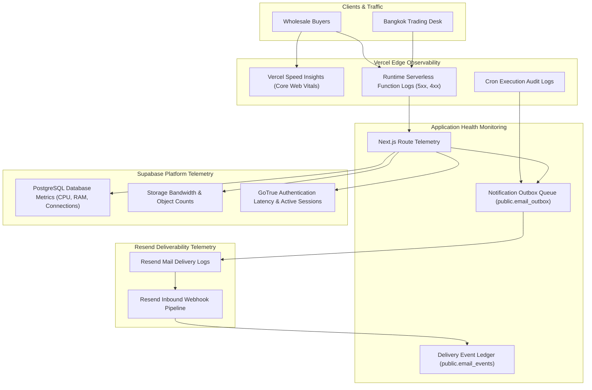

# Libra Gems & Trading Co., Ltd.
## Production Monitoring Baseline & Observability Runbook

**Document Reference:** `docs/07-development/PRODUCTION_MONITORING_BASELINE.md`  
**Classification:** SRE & System Observability Specification  
**Target Domain:** `https://libragems.net`  
**Version:** 1.0.0 (Production Go-Live Baseline)

---

## 1. Observability Architecture & Telemetry Sources



---

## 2. Operational Baselines & Target Metrics

The following operational service level objectives (SLOs) establish the health threshold for the production platform:

| Metric / Dimension | Target Baseline | Degraded Threshold | Critical Incident Threshold (SEV-1/2) | Monitoring Source |
|---|---|---|---|---|
| **Public Homepage TTFB** | $< 350\text{ ms}$ | $> 800\text{ ms}$ | $> 2,000\text{ ms}$ | Vercel Edge / Web Vitals |
| **Largest Contentful Paint (LCP)** | $< 1.8\text{ s}$ | $> 2.5\text{ s}$ | $> 4.0\text{ s}$ | Google PageSpeed / Chrome UX |
| **Cumulative Layout Shift (CLS)** | $< 0.05$ | $> 0.10$ | $> 0.25$ | Vercel Analytics |
| **API Error Rate (5xx)** | $< 0.01\%$ | $> 0.5\%$ | $> 2.0\%$ | Vercel Function Logs |
| **Enquiry API Latency** | $< 400\text{ ms}$ | $> 1,000\text{ ms}$ | $> 3,000\text{ ms}$ | Function Invocation Trace |
| **Email Dispatch Latency** | $< 60\text{ s}$ | $> 5\text{ min}$ | $> 15\text{ min}$ | Outbox created_at to sent_at |
| **Email Bounce Rate** | $< 1.0\%$ | $> 3.0\%$ | $> 5.0\%$ | Resend Analytics |
| **PostgreSQL Connection Count** | $< 15\text{ active}$ | $> 40\text{ active}$ | $> 80\text{ active}$ (Pool Saturation) | Supabase Metrics |
| **Storage Upload Latency** | $< 1.5\text{ s}$ | $> 4.0\text{ s}$ | $> 8.0\text{ s}$ | Supabase Storage API |

---

## 3. Background Outbox Cron Monitoring

### 3.1 Cron Behavior & Plan Tier Architecture
- **Target Route:** `/api/cron/process-outbox`
- **Schedule:** `*/5 * * * *` (Configured in [`apps/web/vercel.json`](file:///d:/web/LibraGems_Project_Starter_Kit/apps/web/vercel.json)).
- **Authorization:** `Authorization: Bearer <CRON_SECRET>`
- **Fail-Closed Behavior:** If `CRON_SECRET` is unset, the handler returns HTTP 500 immediately. If query string secrets are attempted (`?secret=...`), it returns HTTP 400.
- **Account Plan Constraints:**
  * **Vercel Pro:** Executes every 5 minutes.
  * **Vercel Hobby:** Executes at most once daily. As noted in ADR-38, immediate asynchronous dispatch is executed on enquiry receipt, making cron frequency non-blocking for inbound traffic.

### 3.2 Outbox Queue Health Checks (SQL Runbook)
Trading desk administrators can inspect outbox health directly in the admin dashboard at `/admin/communications/outbox` or execute the following read-only queries in Supabase:

```sql
-- 1. Inspect count of pending and failed email notifications
SELECT 
  status, 
  COUNT(*) AS lot_count,
  MIN(created_at) AS oldest_in_queue,
  MAX(attempts) AS max_attempts
FROM public.email_outbox
GROUP BY status;

-- 2. Check for jobs stuck in processing status for > 15 minutes
SELECT id, recipient, subject, attempts, updated_at
FROM public.email_outbox
WHERE status = 'processing'
  AND updated_at < (NOW() - INTERVAL '15 minutes');
```

---

## 4. Error Logging & Alerting

### 4.1 Serverless Function Logs (Vercel)
Monitor runtime errors in the Vercel Dashboard under **Logs**:
- Filter by `status:500` to isolate unhandled exceptions.
- Common failure vectors:
  * Missing environment secrets (`SUPABASE_SERVICE_ROLE_KEY` or `RESEND_API_KEY`).
  * Supabase network timeout or connection exhaustion.
  * Resend rate limit response (HTTP 429).

### 4.2 Webhook Signature Failure Monitoring
If Resend webhooks fail to record delivery events:
- Inspect `/admin/communications/email-events`.
- In Vercel logs, filter for `[Resend Webhook] Signature verification failed`.
- Verify that `RESEND_WEBHOOK_SECRET` in Vercel matches the signing secret in the Resend dashboard.

---

## 5. Security & Access Monitoring

- **Admin Login Failures:** Monitor Supabase Auth logs for repetitive failed authentication attempts against `/admin/login`.
- **Public Rate Limiter Triggers:** Monitor `/api/enquiries` logs for HTTP 429 (`Too Many Requests`) responses indicating potential bot form-scraping or volumetric spam attempts.
- **Payload Cap Enforcements:** Monitor for HTTP 413 (`Payload Too Large`) responses indicating oversized submission payloads ($>64\text{ KB}$).

---

## 6. Incident Escalation Protocol

When degraded thresholds are exceeded, follow the standard escalation procedure documented in [Rollback & Recovery Runbook Section 6](file:///d:/web/LibraGems_Project_Starter_Kit/docs/07-development/ROLLBACK_AND_RECOVERY.md#6-incident-classification--escalation-matrix):
1. **Classify Severity:** SEV-1 (Critical outage / Data breach), SEV-2 (Workflow failure), SEV-3 (Performance degradation), or SEV-4 (Cosmetic).
2. **Execute Initial Triage:** Review Vercel deployment status and Supabase status.
3. **Trigger Rollback:** If a regression is tied to a code release, execute Vercel Instant Rollback to the previous deployment.
4. **Notify Trading Desk:** Alert sales personnel if inbound enquiry dispatch is temporarily delayed.
